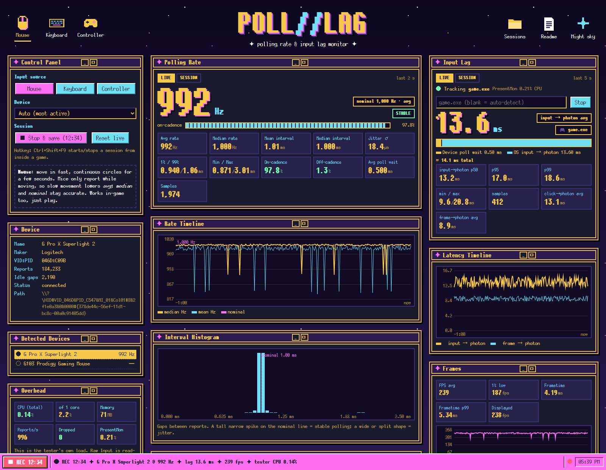
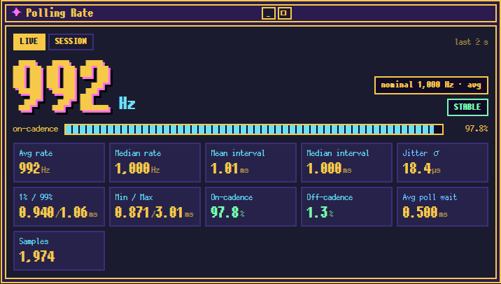
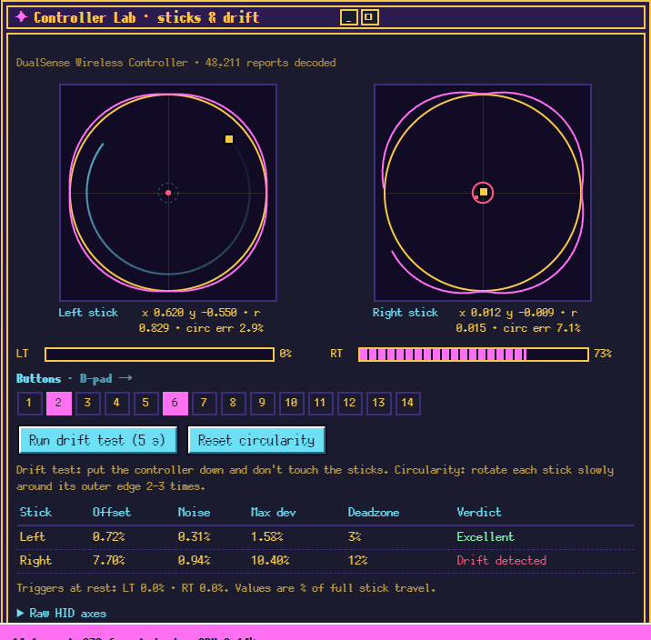
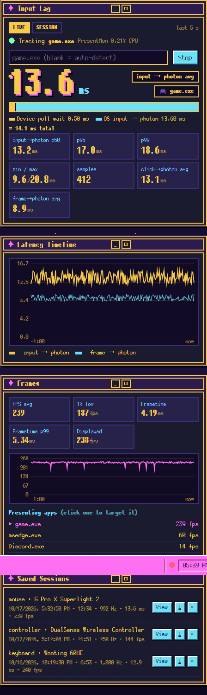
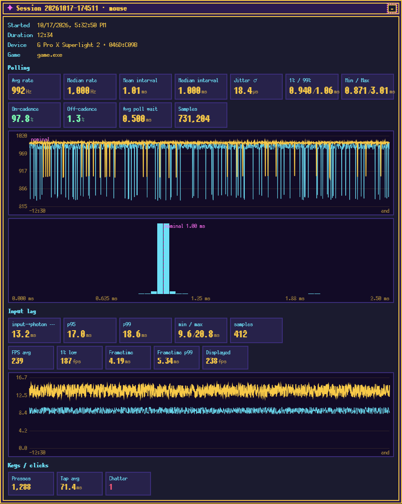
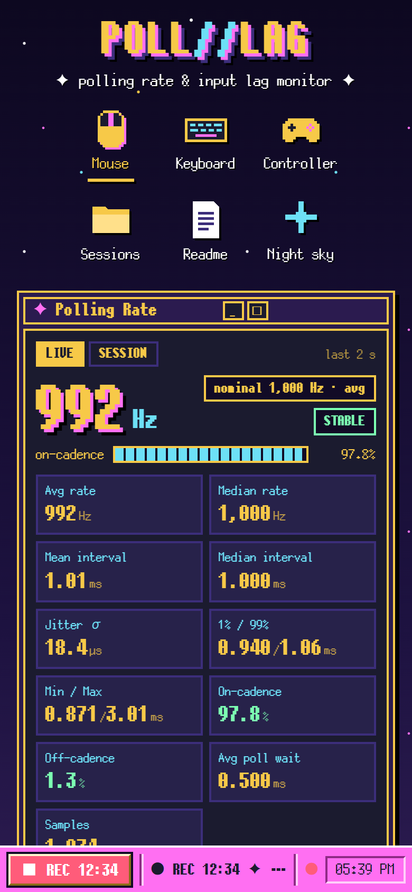

# Poll//Lag Tester

A lightweight Windows tool that measures **polling rate** and **input lag** for your **mouse, keyboard or controller**, *while you play*. It also has a **Controller Lab** for stick drift and circularity. Stats are shown in a retro dashboard in your browser (styled after [the1azreen.neocities.org](https://the1azreen.neocities.org/)). You can open it on a second monitor, or on your phone.



<table>
  <tr>
    <td width="50%"><br><sub><b>Polling rate</b>: live/session rate, nominal snap, jitter, cadence</sub></td>
    <td width="50%"><br><sub><b>Controller Lab</b>: live sticks, drift test, circularity</sub></td>
  </tr>
  <tr>
    <td><br><sub><b>Input lag</b>: input → photon via PresentMon, frames, saved sessions</sub></td>
    <td><br><sub><b>Session report</b>: full-session charts and stats, exportable as JSON</sub></td>
  </tr>
</table>

<p align="center"><br><sub>Run with <code>--lan</code> and keep the stats on your phone while you play.</sub></p>

<sub>Screenshots use sample data so every panel is filled in.</sub>

## Quick start

```powershell
.\build.ps1 -SelfContained        # -> publish\PollLagTester.exe, one file, no .NET install needed
.\publish\PollLagTester.exe       # opens http://localhost:7272
```

`.\build.ps1` without `-SelfContained` makes a ~0.4 MB exe that needs the .NET 8 ASP.NET Core runtime installed. Put the exe somewhere writable (Desktop, Documents): it creates `sessions\` and `tools\` next to itself. The exe isn't code-signed, so SmartScreen may ask you to confirm the first run (**More info → Run anyway**).

Or run straight from source: `dotnet run -c Release --project src/PollLagTester`.

| Option | |
|---|---|
| `--mode mouse\|keyboard\|controller` | input source to start with |
| `--port 7272` | dashboard port |
| `--lan` | also serve the dashboard to your local network (watch stats on your phone while gaming) |
| `--no-browser` | don't auto-open the dashboard |

**Hotkey:** `Ctrl+Shift+F9` starts and stops a recorded session from inside a game. Sessions are saved as JSON in `sessions\` and can be viewed, downloaded or deleted in the dashboard.

## What it measures

### Polling rate (no admin needed)
Uses Windows **Raw Input** with `RIDEV_INPUTSINK`, so it keeps receiving reports while the game has focus. A dedicated high-priority thread timestamps each report with QPC as it arrives. Statistics come from the gaps between consecutive reports from the same device.

- **Mouse:** avg / median / nominal rate (snapped to 125…8000 Hz), interval percentiles, jitter σ, on-cadence % (within ±15% of nominal), off-cadence % (gaps > 1.5×, i.e. skipped polls or slow movement), plus a live timeline and histogram. Move the mouse fast in circles for clean numbers.
- **Keyboard:** keyboards only report when a key changes, so a plain average is meaningless. Each event still lands on a USB poll, though, so the gaps snap to multiples of the poll period. The estimator finds the slowest standard rate whose grid the gaps fit, and reports a confidence. Roll your fingers across keys quickly. Rates above ~2 kHz may be unresolvable because of OS timing jitter.
- **Controller:** any HID gamepad (DualSense/DS4, Xbox via "HID-compliant game controller", Switch Pro, 8BitDo, …). PlayStation pads stream continuously; Xbox pads only report on change.
- **Clicks / keys:** tap durations and **chatter detection**: a re-press under 10 ms after a release is flagged as likely switch bounce.

### Input lag (needs admin + PresentMon)
Uses Intel **[PresentMon](https://github.com/GameTechDev/PresentMon)** (ETW-based, low overhead). PresentMon matches each keyboard/mouse input event the OS receives to the first frame that reaches the display afterwards (**input → photon**). The dashboard shows avg / p50 / p95 / p99 plus FPS, 1% low and frame times. It adds the device's average **poll wait** (½ the poll interval) to give an estimated end-to-end chain.

- Press **Download PresentMon** in the dashboard (fetches the official console build from GitHub into `tools\`), or place `PresentMon-x.y.z-x64.exe` there yourself.
- ETW tracing requires administrator rights: use **Restart as admin** in the dashboard.
- The game is auto-detected (the busiest presenting app, ignoring browsers, launchers and overlays), or you can type `game.exe`.
- **Controllers:** their input isn't visible to the OS input stack, so the chain is an *estimate*: poll wait + ½ frame (the game samples input once per frame) + frame → photon (PresentMon `DisplayLatency`).
- **Not included:** debounce/sensor time inside the device and the monitor's pixel response. Those need a photodiode tester (NVIDIA LDAT, OSLTT, …).

### Controller Lab (sticks & drift)
Inspired by [hardwaretester.com/gamepad](https://hardwaretester.com/gamepad). Decodes the controller's own HID report with the Windows HID parser:
- live left/right stick plots with trail, triggers, buttons and D-pad, and raw HID axes
- **Drift test** (5 s, hands off): resting offset, noise, max deviation, verdict and a suggested deadzone
- **Circularity test**: rotate along the edge; average error vs. a perfect circle, plus sweep coverage

Note: Windows' Xbox HID driver merges both triggers into one axis, so pressing both at once cancels out. That's a Windows limitation, not this tool.

## Why it won't hurt your game

- **Read-only Raw Input:** no hooks, DLL injection, drivers or overlays, and nothing touches the game process.
- Only the selected input class is registered. The collector thread just timestamps and copies into a lock-free ring.
- Statistics run 4×/s on a **below-normal** priority thread using fixed-size histograms (constant memory however long the session).
- Controller HID decoding only runs while the Controller Lab is open or a test is running.
- Opted out of Windows 11 **EcoQoS** throttling so timestamps stay accurate while the game is in the foreground.
- Workstation GC, no background GC threads. The dashboard pauses its stream when the tab is hidden.
- The **Overhead** window shows the tester's own CPU, memory and dropped events, so you can check this yourself.

## Project layout

```
src/PollLagTester/
  RawInputCollector.cs   message-only window + Raw Input, QPC timestamps (hot path)
  Events.cs              lock-free SPSC event ring + HID report ring
  Analyzer.cs            stats, sessions, JSON snapshots (analyzer thread)
  Stats.cs               histograms, interval summary, keyboard poll-grid estimator
  Gamepad.cs             HID gamepad decoding, drift + circularity
  LatencyTracker.cs      PresentMon process + CSV parsing
  Program.cs             Kestrel web server + API
  wwwroot/               dashboard (embedded into the exe)
```

Font: PixelMplus12 (M+ FONT LICENSE).

To refresh the screenshots after changing the UI: `python docs/make_screenshots.py src/PollLagTester/wwwroot docs/screenshots` (needs `pip install playwright`; it uses Microsoft Edge and mocks the API, so the app doesn't have to be running).
